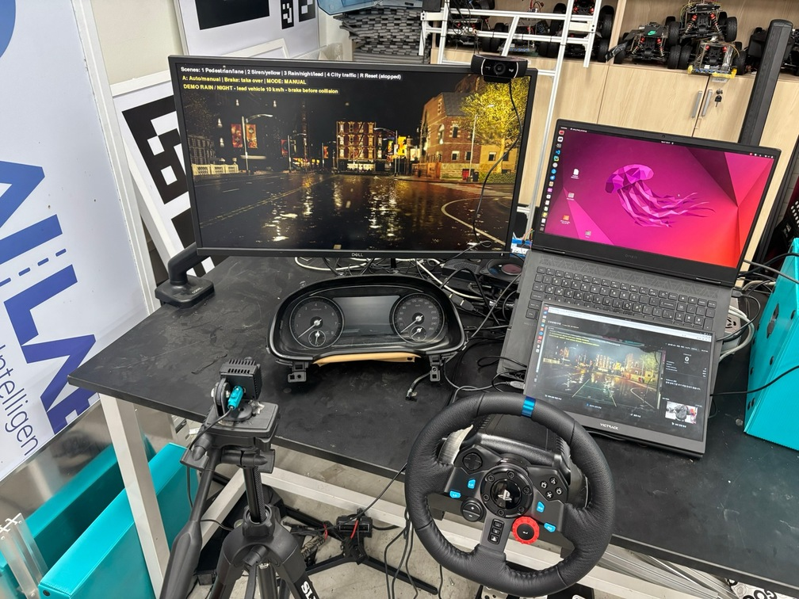
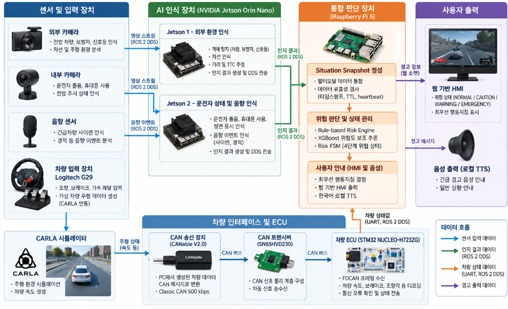
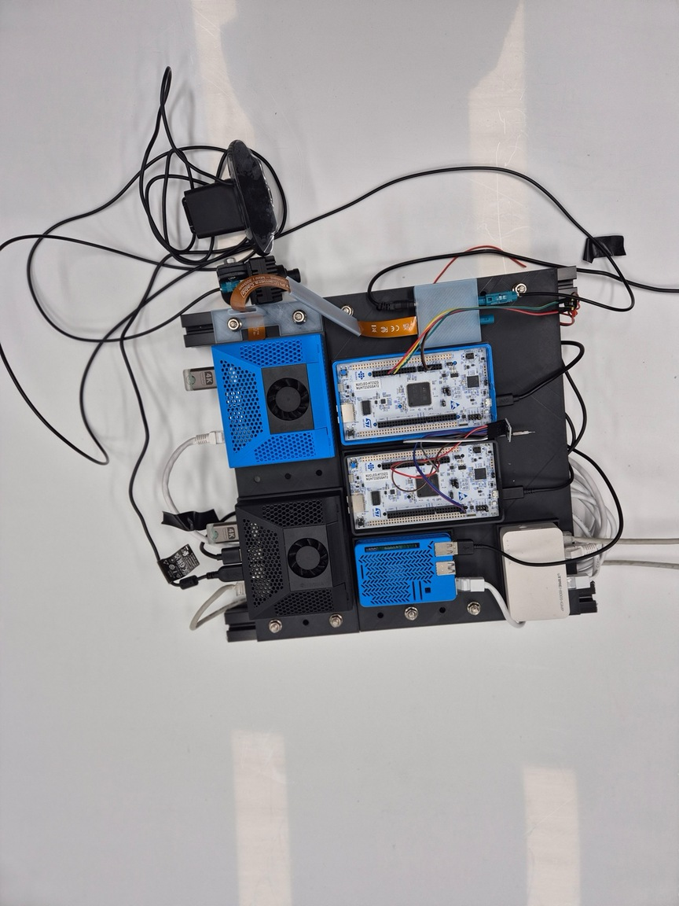
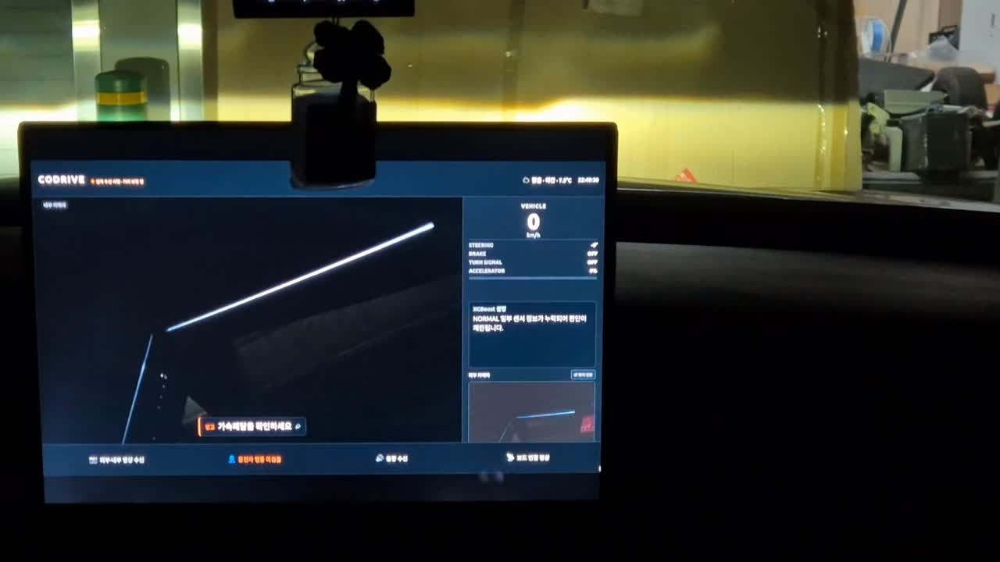
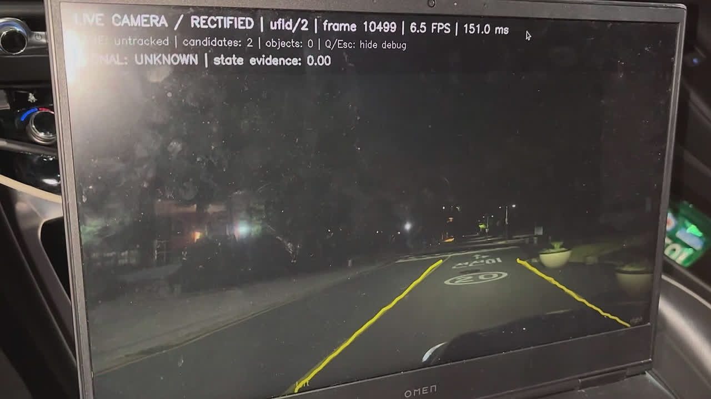

# CODRIVE
### 멀티모달 상황 해석 기반 운전 보조 시스템

**제24회 임베디드SW경진대회 | 자동차/모빌리티 부문**

## 프로젝트 소개

CODRIVE는 차량 외부 환경, 운전자 상태 및 차량 주행 정보를 통합하여 복합 위험을 판단하고, 운전자에게 최우선 행동지침을 제공하는 지능형 운전 보조 시스템입니다.

Jetson, STM32, Raspberry Pi 기반의 분산형 임베디드 시스템으로 구현하였으며, CARLA 시뮬레이션과 실제 차량 환경에서 기능을 검증하였습니다.

## 주요 기능

- **외부 환경 인식:** 차량, 보행자, 차선, 신호등 및 사이렌 감지
- **운전자 상태 인식:** 졸음, 전방 미주시 및 주의 분산 감지
- **차량 데이터 처리:** STM32 FDCAN 기반 속도, 조향각, 브레이크 및 가속 페달 정보 처리
- **복합 위험 판단:** Situation Snapshot, TTC, 차량 동역학, Rule-based Risk Engine 및 XGBoost 활용
- **위험 경고:** 4단계 Risk FSM 기반 경고 우선순위 결정 및 HMI, 음성 안내
- **통신 신뢰성:** ROS 2 DDS, CAN, TTL 및 heartbeat 기반 데이터 상태 관리

## 하드웨어 구성

| 장치 | 역할 |
|---|---|
| NVIDIA Jetson 1 | 외부 주행 환경 및 음향 인식 |
| NVIDIA Jetson 2 | 운전자 상태 인식 |
| STM32 NUCLEO-H723ZG | FDCAN 기반 차량 데이터 수신 및 처리 |
| Raspberry Pi 5 | 데이터 융합, 위험 판단 및 HMI |
| Logitech G29 | 가상 주행 조작 |
| CANable V2.0 | CAN 통신 인터페이스 |

## 개발 환경

- **OS:** Ubuntu 24.04, Windows
- **Language:** Python, C
- **AI:** YOLO, PyTorch, OpenCV, XGBoost
- **Communication:** ROS 2 Jazzy, DDS, Classic CAN 500 kbps
- **Simulation:** CARLA

## 핵심 특징

1. **분산형 임베디드 아키텍처:** 이기종 보드에 인식, 차량 통신, 위험 판단 기능을 분산 구현
2. **실제 CAN 하드웨어 연동:** CARLA 및 G29의 주행 정보를 STM32 FDCAN과 연계
3. **복합 위험 분석:** TTC, 차량 동역학 및 운전자 상태를 통합한 위험 판단
4. **안전 중심 경고:** 긴급 경고와 일반 안내를 분리하여 최우선 행동지침 제공

## 실행 방법

```bash
git clone https://github.com/skysky0214/2026ESWContest_mobility_CODRIVE.git
cd 2026ESWContest_mobility_CODRIVE
```

보드별 소스·의존성·모델·서비스 설치와 SSH 연결을 준비한 뒤, 아래 중 사용할 모드 하나를 실행합니다. CARLA 모드는 서버와 주행 프로그램도 먼저 실행해야 합니다.

```bash
bash scripts/select-integration-mode.sh carla         # CARLA 가상 카메라 입력
bash scripts/select-integration-mode.sh carla-screen  # 실물 카메라로 CARLA 화면 촬영
bash scripts/select-integration-mode.sh real-vehicle  # 실차 카메라 + EQ900/CANable
```

보드 주소·설치 경로 설정 및 카메라 보정은 [실행 안내](docs/INTEGRATION_MODES.md)를 참고하세요. 모드 전환은 정차 상태에서 수행합니다.

## 개발 및 검증

CARLA 기반 가상 주행 환경과 실제 차량 환경에서 기능을 검증하였으며, STM32 CAN 통신과 이기종 임베디드 장치 간 데이터 연동을 확인하였습니다.

---

**CODRIVE Team | 제24회 임베디드SW경진대회**

## 최종 결과물 · 프로젝트 기록


[사진·시연 영상·상세 포트폴리오](https://juuny0317-cmd.github.io/projects/codrive/) · [개발완료보고서](docs/portfolio/development-report.pdf) · [팀 시연 영상](https://youtu.be/mQxMPxAprZU)



외부 영상, 운전자 상태, 음향 이벤트와 CAN 차량 데이터를 하나의 **Situation Snapshot**으로 통합하고, **Rule-based Risk Engine + XGBoost + Risk FSM**으로 가장 시급한 행동지침을 골라 웹 HMI와 한국어 TTS로 출력하는 분산형 운전 보조 시스템을 완성했다. 최종 경고 경로는 외부 LLM 응답을 기다리지 않고 사전 정의된 메시지를 사용한다.

### 최종 하드웨어와 데이터 흐름





```text
외부 카메라 ──> Jetson 1 ──> 객체·차선·신호등 ─┐
내부 카메라 ──> Jetson 2 ──> 운전자 상태      ├─ DDS ─> Raspberry Pi 5
마이크 ──────> 음향 인식 ──> 사이렌·경적      ┘          │
G29 + CARLA ─> CANable ─> CAN Bus ─> STM32 ─> UART ────┤
                                                     v
                                  Snapshot → Rule/XGBoost → Risk FSM
                                                     │
                                                     v
                                        최우선 행동지침 → HMI / TTS
```

### 최종 구현·검증 결과

아래 수치는 **2026-10-28 개발완료보고서의 팀 측정 결과**다. 이 저장소 정리 과정에서 하드웨어 시험을 새로 수행한 값은 아니다.

| 평가 항목 | 보고 결과 |
| --- | --- |
| 평균 종단 지연 | 478ms → 186ms |
| P95 종단 지연 | 600ms → 약 300ms |
| 200ms 이내 경고 완료 | 100회 시험에서 87% |
| 실제 CAN 수신 | 유효 수신 946건 · 통신 오류 카운터 0건 |
| CARLA–CAN–HMI 연동 | 120개 샘플에서 CAN 유효 상태·HMI 수신 확인 |
| 분산 통신 | 세 보드 서비스 6개 · heartbeat 4종 · DDS 데이터 거부 0건 |
| 카메라 보정 | 직선 잔차 1.229px → 0.103px |
| 복합 위험 시나리오 | 4종 각각 10회 이상 · 우선순위 정상 동작 확인 |

평균 지연은 200ms 목표 안에 들어왔지만 P95는 약 300ms였다. 모든 시험에서 200ms를 만족한 것은 아니다. 보고서의 모델 추론시간은 본문·표에서 0.2ms, 2ms, 2.35ms로 달리 기재되어 있으므로 하나의 확정 수치로 통합하지 않는다. 음향의 수집 window 및 확인 횟수도 있으므로 이 결과를 모든 음향 이벤트의 onset-to-alert 지연으로 일반화하지 않는다.

검증 시나리오는 차선 변경 중 위험 객체 출현, 악천후 전방 위험, 사이렌과 적색 신호의 동시 발생, 운전자 졸음·주의분산이다. 수상·순위는 제공 자료에서 확인되지 않아 기재하지 않았다.

### 실차 시연 화면





최종 발표 PPT에 포함된 실차 영상의 미리보기다. [상세 페이지에서 두 시연 영상 보기](https://juuny0317-cmd.github.io/projects/codrive/#demonstration).

### 담당 역할 · 유용준

음향 인식 모델 개발과 함께 최종 종단 지연 개선, Rule-based 로직·FSM 도입, 복합 위험 시나리오 구현, 비용을 고려한 Jetson·Raspberry Pi 역할 분배를 담당했다. 전체 시스템은 CODRIVE 팀의 공동 결과물이다.

- **음향 인식 모델 개발:** 주행 환경 음향 데이터 수집·전처리, 학습 데이터셋과 특징 추출 파이프라인 구성, 사이렌·경적 모델 학습·평가 및 추론 성능 개선
- **최종 종단 지연 개선:** 센서 인지부터 위험 판단과 HMI·TTS 출력까지 최종 경고 파이프라인의 지연 개선
- **Rule-based 로직·FSM 도입:** 명시적 위험 조건과 상태 전이를 도입해 경고 우선순위와 위험 상태의 안정적인 전환을 구성
- **복합 위험 시나리오 구현:** 차선 변경 중 위험 객체, 악천후 전방 위험, 사이렌·적색 신호, 운전자 졸음·주의분산 등의 통합 시험 시나리오 구현
- **비용을 고려한 보드별 역할 분배:** 연산 요구와 하드웨어 비용을 함께 고려해 Jetson에는 인지 처리를, Raspberry Pi에는 데이터 융합·위험 판단·HMI를 배치하는 역할 분담 설계

공개 소스의 음향 파이프라인은 16kHz mono, 960ms rolling window, 100ms hop, 64×96 log-mel 특징과 CNN, EMA·히스테리시스를 사용한다. [음향 파이프라인](docs/AUDIO_PIPELINE.md)과 [음향 통합 기록](docs/AUDIO_INTEGRATION.md)에 구현 및 검증 범위가 정리되어 있다. 초기 모델의 공식 Validation 3,044개 평가에서 사이렌 F1 89.60%, 경적 F1 95.61%를 기록했으며, 이는 초기 모델의 오프라인 평가다. 실차 주변음 오탐, 장시간 false alarms/hour와 외부 마이크 설치 성능은 별도 검증 대상이다.

### 원본 코드와 자료 출처

- 팀 원본: [skysky0214/2026ESWContest_mobility_CODRIVE](https://github.com/skysky0214/2026ESWContest_mobility_CODRIVE)
- 가져온 원본 커밋: `f3c03242173cec68a6d0f45173c75f384901a3de`
- 원본 Git 이력과 소스·설정·펌웨어·모델 파일을 보존했다. 포트폴리오 설명은 이 README 뒤에 덧붙였으며, 사진·구성도·보고서는 `docs/portfolio/`에 추가했다.
- 사진·실차 영상: 사용자 제공 **ESW 최종 발표 자료.pptx**, 슬라이드 4·6. 구성도·수치: **개발완료보고서**, PDF 4·6·8·11~17쪽. 담당 역할은 보고서 19쪽과 개발자 본인의 추가 설명을 함께 반영했다.
- 초기 발표 PDF에는 EV6·LLM API 등 계획 단계 내용이 포함되어 있어, 최종 구현 설명은 완료보고서와 최종 PPT 및 공개 소스 기록을 기준으로 작성했다.

팀원: 서유나(팀장), 권현준, 백건하, 유용준, 황예은 · 건국대학교 CODRIVE
